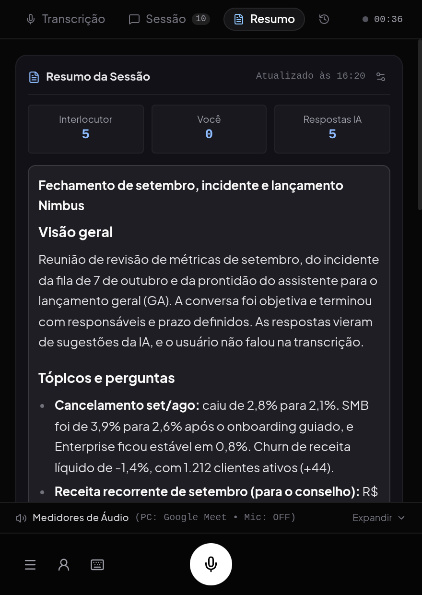
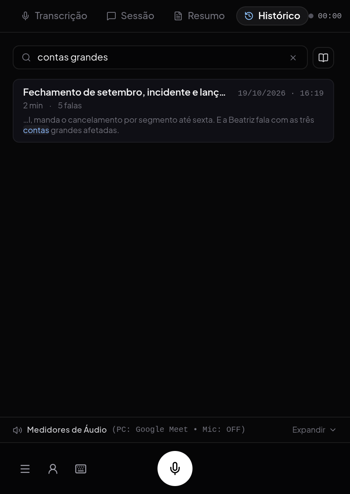
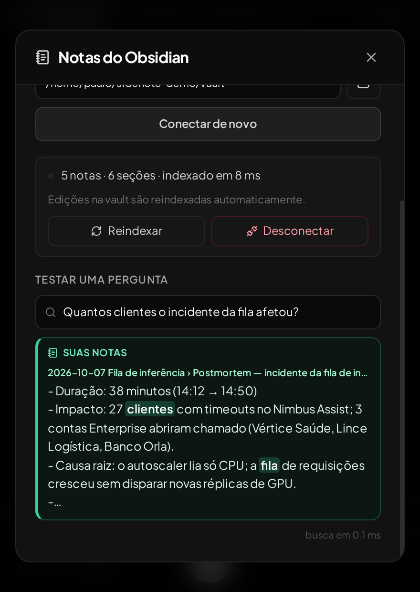

# Sidenote

Copiloto desktop para reuniões. Ele ouve a chamada, transcreve enquanto as pessoas falam, traz na hora o trecho das suas notas que responde ao que foi perguntado, sugere o que dizer numa janela flutuante e, no fim, guarda um resumo com decisões e próximos passos. Serve para reuniões de time, 1:1s, chamadas com clientes e aulas. Roda no Linux e no Windows.

- Captura do áudio do PC (Linux e Windows) e gravação pelo microfone. No Linux, dá para ouvir só o aplicativo da reunião em vez do desktop inteiro.
- Transcrição durante a fala e sugestões automáticas; com Antigravity ou API key, elas começam antes de a pergunta terminar.
- **Transcrição local e privada**, se quiser: além do reconhecimento gratuito do Google, quatro modelos rodam no próprio computador (Parakeet, Whisper large-v3-turbo na placa de vídeo, Whisper small/base e Vosk), baixados pelo app. O áudio da reunião não sai da máquina.
- **Resumo da sessão** em Markdown (visão geral, tópicos, pontos de atenção, decisões e próximos passos), salvo numa pasta ou na sua vault do Obsidian.
- **Histórico de reuniões** com busca: cada reunião encerrada fica com resumo, transcrição e um título escolhido pelo modelo, datada pela hora em que terminou.
- **Contexto da reunião**: quem é você, com quem é a conversa, o assunto e o que precisa sair dela. Arraste uma pauta, uma proposta ou material da empresa (PDF, DOCX, TXT ou MD) e a IA preenche os campos.
- **Modos de conversa**: reunião, vendas e outros, cada um com seu jeito de responder.
- **Notas do Obsidian**: trechos relevantes da sua vault aparecem enquanto a pessoa fala e entram no contexto da resposta.
- Ctrl+Alt+S envia uma captura da tela (um slide, um código, um erro) diretamente ao agente.
- Modo compacto (Alt+C): janela pequena com só a última resposta, os medidores e o menu.
- **Provedores encontrados na sua máquina**: o app procura os CLIs instalados (Antigravity, Codex, Claude Code e OpenCode), as keys salvas ou em variáveis de ambiente e os runtimes locais, e mostra só o que achou; o resto fica em "Outros provedores", com o que falta para cada um.
- **Chaves de API** próprias para OpenAI, Anthropic, Google Gemini, OpenRouter, Groq, DeepSeek, Mistral e xAI, com os modelos listados pela sua conta.
- **Modelos locais** pelo Ollama ou pelo LM Studio: o app escaneia CPU, RAM e placa de vídeo, recomenda o melhor modelo que roda rápido nessa máquina (Qwen 3.5/3.6, Gemma 4, GPT-OSS) e baixa com um clique. A conversa não sai do computador.
- **Google Agenda e Docs**: a reunião da agenda (participantes, descrição e Docs anexados) entra no contexto das sugestões e do resumo; importe um Google Docs no perfil e salve reuniões no Docs.

<p align="center">
  
</p>

| Resumo da reunião | Histórico com busca | Notas do Obsidian |
| :---: | :---: | :---: |
|  |  |  |

| Menu | Modelo de IA |
| :---: | :---: |
|  |  |

<sub>Capturas de uma reunião simulada: as falas foram geradas por TTS e tocadas como se fossem o áudio do Meet; empresa, pessoas, números e a vault são fictícios. A transcrição, as notas, as sugestões e o resumo saíram do app de verdade.</sub>

## Baixar

O instalador e o executável portátil para Windows estão na [página de releases](https://github.com/rabpaulo/sidenote/releases/latest). Para rodar a partir do código (Linux ou Windows), siga as seções abaixo.

## Requisitos

- **Linux** com PipeWire/PulseAudio (`pactl` e `parec`) para capturar o áudio do PC, ou **Windows 10/11** (o áudio do sistema é capturado pelo próprio app).
- Node.js **22.12+** e npm.
- Nada mais para transcrever: o reconhecimento padrão (Parakeet) roda dentro do app, e o modelo (670 MB) é baixado na tela de boas-vindas.
- Opcional: Python 3 com `SpeechRecognition` para o reconhecimento online do Google, e o pacote Python dos outros motores locais (`faster-whisper` ou `vosk`) ou o `whisper-server` do whisper.cpp. O app mostra o comando de instalação em **Menu → Reconhecimento de voz**; veja o [guia de desenvolvimento](docs/development.md#reconhecimento-de-voz-local).
- Uma chave de API de um dos provedores suportados, um dos CLIs (`agy`, `codex`, `claude` ou `opencode`) instalado e autenticado, ou o [Ollama](https://ollama.com)/[LM Studio](https://lmstudio.ai) para rodar um modelo local.
- Opcional: uma conta Google para a agenda e o Docs; veja o [guia de uso](docs/usage.md#google-agenda-e-docs).
- `xrandr` (opcional, Linux/X11) para escolher o monitor da captura de tela pelo nome.
- Internet para as respostas do provedor (e para o reconhecimento pelo Google, se escolhido).

## Executar

```bash
git clone https://github.com/rabpaulo/sidenote.git
cd sidenote
npm ci
npm start
```

Na primeira abertura, a tela de boas-vindas pede o que falta: uma API key (Gemini e Groq têm plano gratuito), um CLI com login ou um modelo local, e o download do modelo de reconhecimento de voz.

O app também usa os CLIs autenticados: encontra `agy`, `codex` e `claude` no `PATH` (no Windows, também os atalhos `.cmd` do npm). Se o CLI estiver em outro lugar, informe o caminho:

```bash
CLAUDE_BIN="$(command -v claude)" npm start
```

```powershell
$env:CLAUDE_BIN = (Get-Command claude).Source; npm start
```

Selecione o provedor correspondente em **Menu → Modelo**, no ícone ☰ da barra inferior. `npm start` inicia o frontend, abre o Electron e inicia ou reaproveita o backend na porta 3001. O áudio do PC tenta iniciar automaticamente.

Para instalar as dependências de áudio e entender os modos de execução, consulte o [guia de desenvolvimento](docs/development.md).

## Usar

1. No menu (☰) da barra inferior, escolha o modelo e o modo da conversa (reunião, vendas e outros).
2. Opcional: abra **Meu contexto**, no ícone de pessoa da barra inferior, e preencha o que a IA deve saber sobre você. Na aba **Perfil**, arraste um currículo ou bio para importar; a IA preenche os campos e os projetos. Revise e ajuste.
3. Na aba **Conversa**, diga com quem é a reunião, o assunto, os pontos importantes e o seu objetivo, ou arraste a pauta ou um material da empresa (por exemplo: “faz produtos de IA generativa e uma plataforma de GPUs”). Salve. O perfil fica em `~/.local/share/sidenote/profile.json` (Linux) ou `%APPDATA%\Sidenote\profile.json` (Windows) e persiste entre execuções.
4. Confira a captura nos medidores de áudio. No Linux, o seletor abaixo de **PC CALL** permite ouvir só o aplicativo da reunião em vez do desktop inteiro. No modo automático, as falas do PC geram sugestões (com Antigravity ou API key, já durante a fala); use **Diga isso** em uma fala da transcrição ou Ctrl+D para solicitar uma manualmente.
5. Para enviar uma mensagem de voz ao agente, use o microfone ou segure **Espaço** com o app em foco.
6. Ao terminar, **Nova sessão** (Alt+N) move a reunião para a aba **Histórico**, com título escolhido pelo modelo, data e hora do fim, resumo e busca.

A importação usa o provedor selecionado e só altera o rascunho: nada é salvo até você clicar em **Salvar**. O `contexto.md` é local e está no `.gitignore`; não acompanha o clone. Em **Extras**, importar o arquivo acrescenta o texto às notas do perfil.

O fim da fala é detectado por uma pausa de aproximadamente 900 ms. Isso pode dividir uma pergunta com pausas longas. A latência também depende da transcrição e do modelo; não há garantia de resposta instantânea.

## Gerar pacote para Windows

Numa máquina Windows:

```powershell
npm run build:win
```

São gerados em `release/` o instalador `Sidenote-1.0.0-setup.exe` e o executável portátil `Sidenote-1.0.0-portable.exe`. Basta uma API key ou um CLI autenticado na máquina; o Python só é necessário para os motores de voz opcionais. O app não é assinado; o SmartScreen pode pedir confirmação na primeira execução.

## Gerar AppImage

Para gerar o pacote executável portátil `.AppImage` (Linux x64):

```bash
npm run build:appimage
# ou execute o script auxiliar:
./scripts/build-appimage.sh
```

O arquivo executável será gerado no diretório `release/`:

```bash
chmod +x "release/Sidenote-1.0.0.AppImage"
./release/Sidenote-1.0.0.AppImage
```

## Documentação

- [Uso, provedores, modelos locais, Google Agenda e Docs, contexto pessoal, reconhecimento de voz, histórico de reuniões e atalhos](docs/usage.md)
- [Instalação, arquitetura e testes](docs/development.md)
- [Fluxo de áudio e diagnóstico de latência](docs/response-latency.md)
- [Política de privacidade](https://rabpaulo.github.io/sidenote/privacy.html)

```bash
npm test
npm run build
```

Os testes usam serviços simulados. O uso normal envia áudio ao serviço de reconhecimento do Google (a menos que um motor local esteja em uso) e texto ao provedor selecionado; as respostas seguem os limites da conta autenticada.

## Licença

[MIT](LICENSE)
