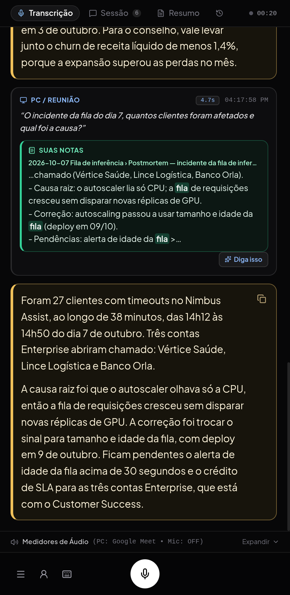
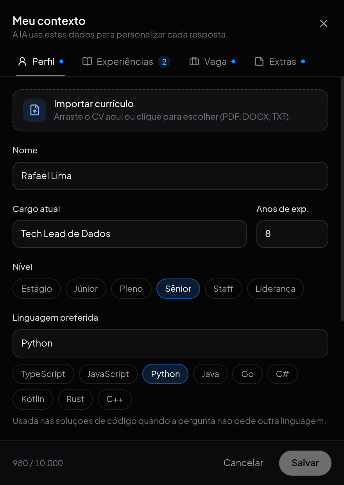
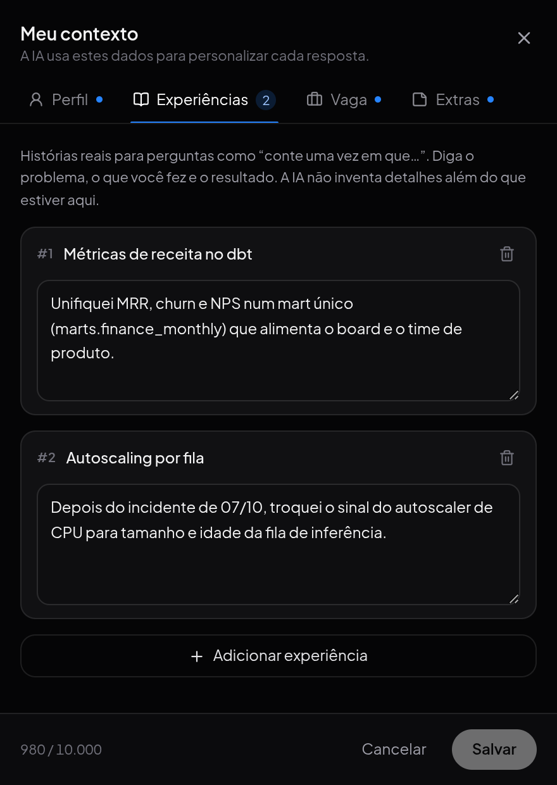
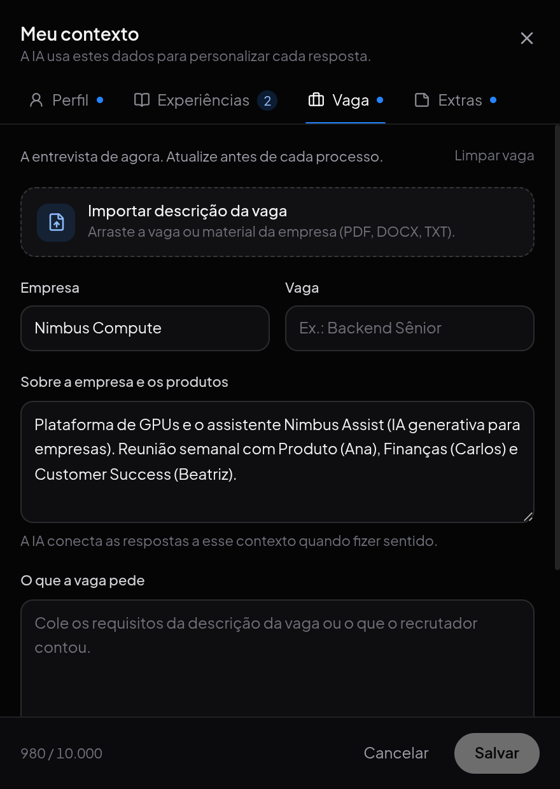
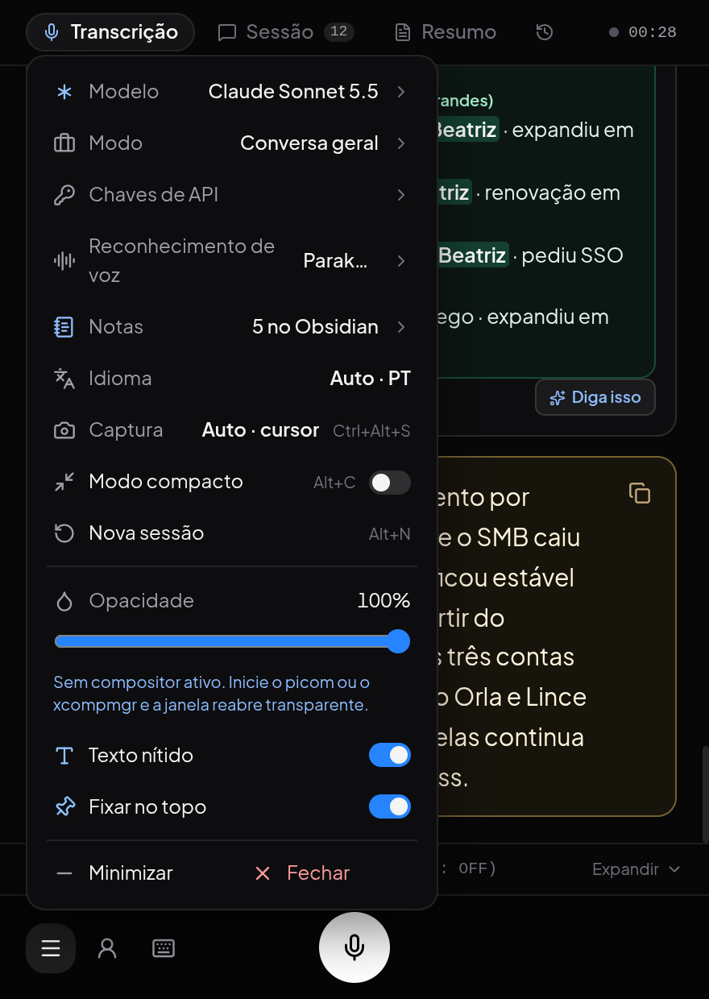
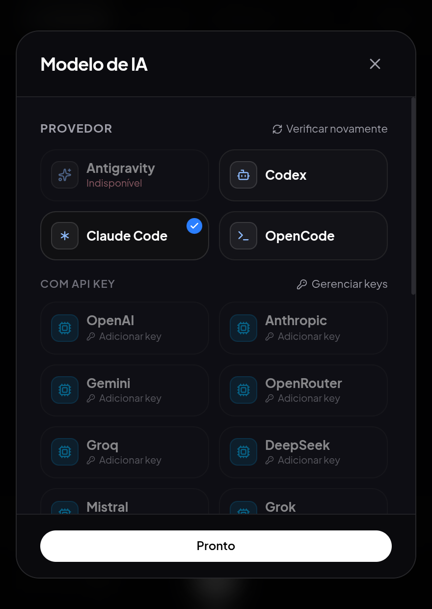

# Sidenote

Copiloto desktop para conversas em tempo real. Ele ouve a chamada, transcreve enquanto as pessoas falam, sugere o que responder numa janela flutuante e, no fim, guarda um resumo com decisões e próximos passos. Serve para reuniões, 1:1s, aulas, chamadas de vendas e entrevistas. Roda no Linux e no Windows.

- Captura do áudio do PC (Linux e Windows) e gravação pelo microfone. No Linux, dá para ouvir só o aplicativo da reunião em vez do desktop inteiro.
- Transcrição durante a fala e sugestões automáticas; com Antigravity ou API key, elas começam antes de a pergunta terminar.
- **Transcrição local e privada**, se quiser: além do reconhecimento gratuito do Google, quatro modelos rodam no próprio computador (Parakeet, Whisper large-v3-turbo na placa de vídeo, Whisper small/base e Vosk), baixados pelo app. O áudio da reunião não sai da máquina.
- **Resumo da sessão** em Markdown (visão geral, tópicos, pontos de atenção, decisões e próximos passos), salvo numa pasta ou na sua vault do Obsidian.
- **Histórico de reuniões** com busca: cada reunião encerrada fica com resumo, transcrição e um título escolhido pelo modelo, datada pela hora em que terminou.
- **Modos de conversa**: geral, vendas e entrevistas (código, system design, comportamental, RH), cada um com seu jeito de responder.
- **Contexto pessoal**: perfil, experiências e notas que personalizam as sugestões. Arraste um currículo ou um documento (PDF, DOCX, TXT ou MD) e a IA preenche os campos.
- **Notas do Obsidian**: trechos relevantes da sua vault aparecem enquanto a pessoa fala e entram no contexto da resposta.
- Ctrl+Alt+S envia uma captura da tela (um slide, um código, um erro) diretamente ao agente.
- Modo compacto (Alt+C): janela pequena com só a última resposta, os medidores e o menu.
- Integração com os CLIs autenticados do Antigravity, do Codex, do Claude Code e do OpenCode.
- **Chaves de API** próprias para OpenAI, Anthropic, Google Gemini, OpenRouter, Groq, DeepSeek, Mistral e xAI, com os modelos listados pela sua conta.

<p align="center">
  
</p>

| Contexto pessoal | Experiências | Contexto da empresa |
| :---: | :---: | :---: |
|  |  |  |

| Menu | Modelo de IA |
| :---: | :---: |
|  |  |

<sub>Capturas com dados fictícios de demonstração.</sub>

## Requisitos

- **Linux** com PipeWire/PulseAudio (`pactl` e `parec`) para capturar o áudio do PC, ou **Windows 10/11** (o áudio do sistema é capturado pelo próprio app).
- Node.js **22.12+** e npm.
- Python 3 com `SpeechRecognition`. O `ffmpeg` é necessário no Linux e opcional no Windows.
- Opcional, para transcrever sem internet: o pacote Python do motor local escolhido (`sherpa-onnx`, `faster-whisper` ou `vosk`) ou o `whisper-server` do whisper.cpp. O app mostra o comando de instalação em **Menu → Reconhecimento de voz**; veja o [guia de desenvolvimento](docs/development.md#reconhecimento-de-voz-local).
- Uma chave de API de um dos provedores suportados ou um dos CLIs (`agy`, `codex`, `claude` ou `opencode`) instalado e autenticado.
- `xrandr` (opcional, Linux/X11) para escolher o monitor da captura de tela pelo nome.
- Internet para as respostas do provedor e para o reconhecimento pelo Google.

## Executar

```bash
git clone git@github.com:rabpaulo/Interview-AI.git
cd Interview-AI
npm ci
npm start
```

No Windows, instale antes o Python e a biblioteca de reconhecimento (PowerShell):

```powershell
py -m pip install SpeechRecognition
npm ci
npm start
```

O app encontra `agy`, `codex` e `claude` no `PATH` (no Windows, também os atalhos `.cmd` do npm). Se o CLI estiver em outro lugar, informe o caminho:

```bash
CLAUDE_BIN="$(command -v claude)" npm start
```

```powershell
$env:CLAUDE_BIN = (Get-Command claude).Source; npm start
```

Selecione o provedor correspondente em **Menu → Modelo**, no ícone ☰ da barra inferior. `npm start` inicia o frontend, abre o Electron e inicia ou reaproveita o backend na porta 3001. O áudio do PC tenta iniciar automaticamente.

Para instalar as dependências de áudio e entender os modos de execução, consulte o [guia de desenvolvimento](docs/development.md).

## Usar

1. No menu (☰) da barra inferior, escolha o modelo e o modo da conversa (geral, vendas ou um tipo de entrevista).
2. Opcional: abra **Meu contexto**, no ícone de pessoa da barra inferior, e preencha o que a IA deve saber sobre você. Na aba **Perfil**, arraste um currículo para **Importar currículo**; a IA preenche os campos e as experiências. Revise e ajuste.
3. Se a conversa for com uma empresa (cliente, parceiro ou processo seletivo), preencha a aba **Vaga** com empresa e **Sobre a empresa e os produtos** (por exemplo: “faz produtos de IA generativa e uma plataforma de GPUs”), ou arraste um documento sobre ela. Salve. O perfil fica em `~/.local/share/sidenote/profile.json` (Linux) ou `%APPDATA%\Sidenote\profile.json` (Windows) e persiste entre execuções.
4. Confira a captura nos medidores de áudio. No Linux, o seletor abaixo de **PC CALL** permite ouvir só o aplicativo da reunião em vez do desktop inteiro. No modo automático, as falas do PC geram sugestões (com Antigravity ou API key, já durante a fala); use **Diga isso** em uma fala da transcrição ou Ctrl+D para solicitar uma manualmente.
5. Para enviar uma mensagem de voz ao agente, use o microfone ou segure **Espaço** com o app em foco.
6. Ao terminar, **Nova sessão** (Alt+N) move a reunião para a aba **Histórico**, com título escolhido pelo modelo, data e hora do fim, resumo e busca.

A importação usa o provedor selecionado e só altera o rascunho: nada é salvo até você clicar em **Salvar**. O `contexto.md` é local e está no `.gitignore`; não acompanha o clone. Em **Extras**, importar o arquivo acrescenta o texto às notas do perfil.

O fim da fala é detectado por uma pausa de aproximadamente 900 ms. Isso pode dividir uma pergunta com pausas longas. A latência também depende da transcrição e do modelo; não há garantia de resposta instantânea.

## Gerar pacote para Windows

Numa máquina Windows:

```powershell
npm run build:win
```

São gerados em `release/` o instalador `Sidenote-1.0.0-setup.exe` e o executável portátil `Sidenote-1.0.0-portable.exe`. O Python, a biblioteca `SpeechRecognition` e o CLI do provedor precisam estar instalados na máquina. O app não é assinado; o SmartScreen pode pedir confirmação na primeira execução.

## Gerar AppImage

Para gerar o pacote executável portátil `.AppImage` (Linux x64):

```bash
npm run build:appimage
# ou execute o script auxiliar:
./scripts/build-appimage.sh
```

O arquivo executável será gerado no diretório `release/`:

```bash
chmod +x "release/Sidenote-1.0.0.AppImage"
./release/Sidenote-1.0.0.AppImage
```

## Documentação

- [Uso, contexto pessoal, importação de currículo e vaga, reconhecimento de voz, histórico de reuniões e atalhos](docs/usage.md)
- [Instalação, arquitetura e testes](docs/development.md)
- [Fluxo de áudio e diagnóstico de latência](docs/response-latency.md)

```bash
npm test
npm run build
```

Os testes usam serviços simulados. O uso normal envia áudio ao serviço de reconhecimento do Google (a menos que um motor local esteja em uso) e texto ao provedor selecionado; as respostas seguem os limites da conta autenticada.

## Licença

[MIT](LICENSE)
